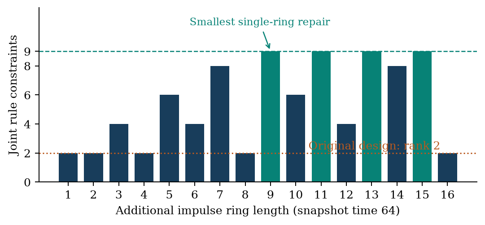

# Frobenius Lens

**Exact experiment audits for periodic scalar linear cellular automata.**

A periodic simulator can return the same snapshots for different local rules. Frobenius Lens reports the complete invisible rule subspace for a declared experiment design and helps find an additional experiment that removes it.

Author: Shivam Gupta · Independent Researcher

**Journal status:** Submitted for consideration to the Journal of Cellular Automata on 17 October 2026; editorial acknowledgment pending. [Submitted journal manuscript](paper/journal/Frobenius_Lens_JCA_Submission.pdf).

[Read the paper](paper/Frobenius_Lens_Shivam_Gupta.pdf) · [Open the interactive app](https://shi1720.github.io/frobenius-lens/) · [Proof and claim boundary](docs/RESEARCH_SCOPE.md)

## A counterintuitive, fully checked example

For binary rules with radius at most four, impulse snapshots at time 64 on rings of **32, 64, and 128** cells leave **128 compatible rules**. Add a **nine-cell** impulse experiment at the same time and every one of the 512 rules is distinguishable. Adding a 256-cell ring still leaves 32 compatible rules.



This is an exact result for a finite, declared class. The code does not certify the correctness of arbitrary nonlinear or otherwise unrestricted simulation programs.

## Reproduce

Tested on Python 3.12.14, SymPy 1.14.0, and Node 22+; core calculations use exact finite-field arithmetic.

```sh
python3 -m venv .venv
. .venv/bin/activate
python -m pip install -e '.[research]'
python -m unittest discover -s tests -v
python experiments/run.py
node tests/test_browser_kernel.mjs
python experiments/figures.py
```

The primary run executed **32,051 assertions with zero failures**. The separate browser kernel passed **17,890 checks**. These counts include exhaustive bounded configuration checks and deterministic pseudorandom suites; they are not independent statistical observations or estimates of real coding-error rates. The unit suite contains 10 methods, including 180 recovery configurations.

The frozen primary protocol is in `experiments/protocol.json`; `results/` contains raw per-configuration data and the executed summaries. Hashes, environment, and timing qualifications are recorded there. Re-execution overwrites generated result files; wall-clock timings will differ.

## Use the exact certificate

```python
from frobenius_lens import Experiment, certificate, recover

E = [Experiment(n, 64) for n in (32, 64, 128)]
print(certificate(E, radius=4)["fiber_size"])  # 128
E.append(Experiment(9, 64))
print(certificate(E, radius=4)["fiber_size"])  # 1
```

`Experiment(n, t, seed=(1,))` uses coefficients in increasing cell order. A rule is a vector at shifts `-r,...,+r` with update `new[i] = sum(rule[j+r] * old[i-j]) mod p`. `p` must be prime, `t` must be `p**a`, and observations must cover the full ring. The radius is an upper bound; endpoint coefficients may be zero.

`recover(E, observations, radius, p)` returns a compatible rule and the complete ambiguity certificate. It rejects inconsistent observations; it does not manufacture uniqueness. `minimum_repair` exactly searches a finite positive-cost menu of at most 22 entries. Its running time is exponential in menu size.

## Interactive app

```sh
python3 -m http.server 8765 --directory app
```

Open `http://localhost:8765`. Start with the default design, click **Find smallest impulse repair**, then **Apply repair**. Rank changes from 2/9 to 9/9; compatible rules change from 128 to 1. The original witness pair remains visible.

The app is binary only. Its kernel is a factorization-free implementation using vector dependence and BigInt polynomial arithmetic; it is tested separately against the Python results. It runs locally after loading two static files. It does not call an LLM or send experiment data to a server.

## Manuscript and evidence

Five vector figures, theorem proofs, protocol details, a literature positioning section, exact results, and limitations are in the manuscript. Compile with:

```sh
mkdir -p build
tectonic -X compile paper/main.tex --outdir build
```

- `src/`: exact symbolic implementation.
- `tests/independent.py`: simulator and rank verifier without SymPy or core imports.
- `experiments/`: declared protocol, complete experiment runner, figure generation.
- `results/`: complete finite checks and machine-readable summaries.
- `app/`: interactive demonstration and independent binary kernel.
- `docs/`: scope, literature search, and practical application assessment.

The mathematical ingredients are classical. The contribution is a seed-aware, joint experiment audit with explicit ambiguity, constructive witnesses, and repair. No acceptance, peer review, unrestricted novelty, patentability, or commercial validation is claimed.

## License

Software: MIT. Manuscript and generated figures/results: CC BY 4.0; see `LICENSE` and `CONTENT_LICENSE.md`.
